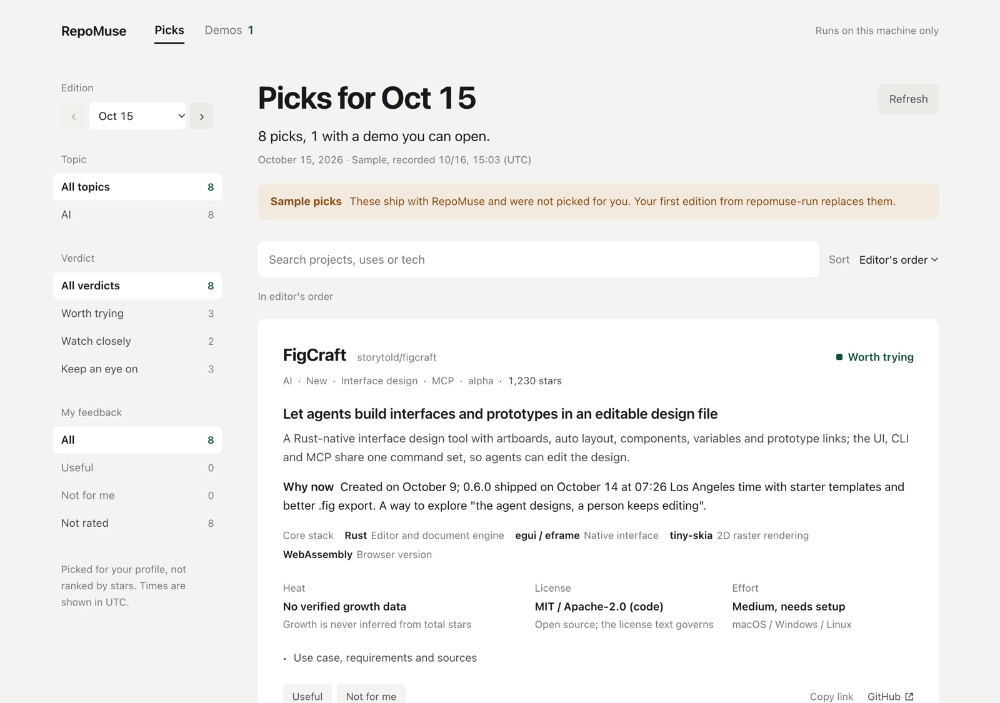
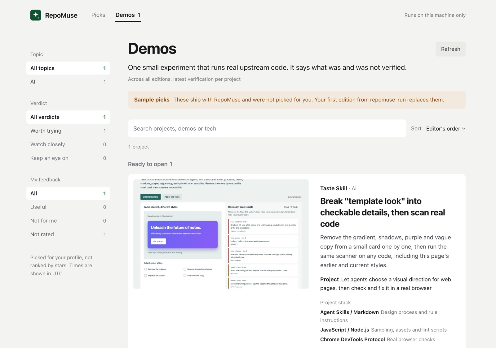
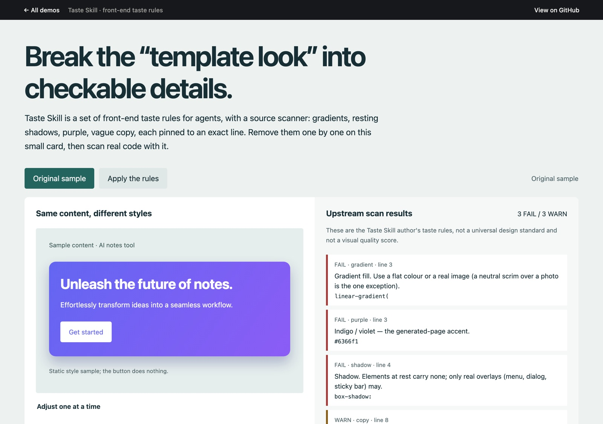

<h1 align="center">RepoMuse</h1>

<p align="center"><strong>A personalized feed of GitHub projects, each shown with a demo your agent built so you can try it.</strong></p>

<p align="center">
  <b>English</b> · <a href="README.zh-CN.md">简体中文</a> · <a href="README.ja.md">日本語</a>
</p>

<p align="center">
  <a href="https://github.com/k4rrox/RepoMuse/actions/workflows/ci.yml"></a>
  <a href="LICENSE"></a>
  
  
</p>

---

Install RepoMuse into your coding agent and tell it what you care about. On the schedule you choose, it
reads GitHub for you, picks the few projects worth your time, explains **why each one fits you**, and for the
ones that are easiest to understand by touching, **builds a small demo on the real upstream code** that you can
open in a browser tab. You mark picks *useful* or *not for me*; the agent reads that before the next run.

- **Personal, not popular.** Picks follow your `profile.md` and your feedback, never a star ranking.
  An empty edition is a valid edition.
- **Demos you can try.** Each demo pins an upstream commit, runs sandboxed with no network access, and says
  exactly what was and was not verified (`ready`, `blocked` or `failed`).
- **Facts with timestamps.** Stars are dated snapshots, growth is shown only with its source window, every
  link is HTTPS, and nothing is published unless the validator passes.
- **Small on purpose.** No framework, no build step, no database. Clone it and it runs.

<p align="center">
  
  
  
</p>

## Try it in 30 seconds

```bash
git clone https://github.com/k4rrox/RepoMuse && cd RepoMuse
./run.sh
```

Open http://127.0.0.1:53265/. You will see labelled **sample picks** and one sample demo (demos run on port 53266).
Needs Python 3.9+ (already on macOS and most Linux). On Windows run `python -m repomuse serve`; optionally
`pip install tzdata` so the chat digest can convert times to your timezone (the page always can).

## Make it yours

Open the folder in your agent and say:

> Set up RepoMuse for me.

The agent follows [`skills/repomuse-setup`](skills/repomuse-setup/SKILL.md): it asks up to seven
questions (interests, stack, what to skip, how often, language, whether it may build demos on its own, page or
chat), writes `profile.md` and `repomuse.json`, and offers to schedule recurring runs. After that:

> Run RepoMuse. &nbsp;&nbsp;·&nbsp;&nbsp; Build a demo for that second pick.

| Agent | How it finds the instructions |
| --- | --- |
| Claude Code | `CLAUDE.md` in the repo, or as a plugin: `/plugin marketplace add k4rrox/RepoMuse`, then `/plugin install repomuse@repomuse` |
| Codex, Cursor, Gemini CLI and others | `AGENTS.md` in the repo routes to the three skills in `skills/` |

Any agent that can read files, browse GitHub and run shell commands can drive it.

## Page or chat

Set `"mode"` in `repomuse.json`. Both modes share the same picks, feedback and demos, so you can switch any time.

| | `"mode": "ui"` (default) | `"mode": "no-ui"` |
| --- | --- | --- |
| Picks | a local page with filters, search and a demo library (`./run.sh`) | a Markdown digest the agent posts in the chat (`repomuse digest`) |
| Feedback | *Useful* / *Not for me* buttons | tell the agent "1 useful, 3 not for me" (`repomuse vote`) |
| Demos | *Open demo* on the card | `repomuse demo <slug>` serves only the demos and opens one in your browser |
| Always running | the local server | nothing |

A digest looks like this:

```markdown
## RepoMuse · 2026-10-15 · 8 picks

### 4. [Taste Skill](https://github.com/Leonxlnx/taste-skill) · Worth trying
Let agents choose a visual direction for web pages, then check and fix it in a real browser

**Why now** The v2.0.0 rewrite shipped on October 13 at 14:05 Los Angeles time, adding scripts, a reference library and browser checks. Recent star growth not verified.
97,067 stars (2026-10-15 15:02) · MIT · Effort: Medium, needs setup
**Verified demo** Break "template look" into checkable details, then scan real code. Try it: `python3 -m repomuse demo taste-skill`
```

## Demo settings

`demos` in `repomuse.json` sets how far the agent goes. Write only the keys you change.

```json
"demos": { "policy": "ask", "scope": "medium", "allow_installs": true, "max_per_run": 1 }
```

| Key | Values |
| --- | --- |
| `policy` | `auto` builds demos on its own · `ask` (default) proposes one and waits for your yes · `off` builds none |
| `scope` | `small` one feature on one page · `medium` (default) several interactions, may bundle packages · `large` a fuller scenario with heavier local builds |
| `allow_installs` | `true` (default) lets the agent install packages inside the demo folder; `false` allows only files that run as they are |
| `max_per_run` | demos per edition, 0-5 (default 1) |

`attach-demo` enforces `policy`, `max_per_run` and `allow_installs`; the demo skill keeps each demo within `scope`.

## How it works

```text
profile.md + feedback ──▶ agent runs repomuse-run ──▶ publish (validated, merged) ──▶ page or chat digest
        ▲                    │                                                              │
        │                    └─▶ repomuse-demo ──▶ demos/<slug>/ (sandboxed) ────────────────┤
        └──────────────── "useful" / "not for me" ◀─────────────────────────────────────────┘
```

| Piece | What it is |
| --- | --- |
| `skills/` | The editor's rules: setup, one run, one demo. Plain Markdown any agent can follow. |
| `repomuse/` | Standard-library Python: data contract, validator, publisher, digest, local server, CLI. |
| `web/` | The page: one HTML file, one stylesheet and plain ES modules in `web/js/` (no build step). |
| `demos/radar-kit/` | Shared top bar every demo uses to link back. |
| `docs/edition-format.md` | Every field the agent writes and the rules that keep it honest. |

### Your files

All personal state lives in the checkout and is **gitignored**, so `git pull` updates never conflict:

| File | Written by | Holds |
| --- | --- | --- |
| `profile.md` | you and the agent | what to watch, what to skip, what the agent has noticed |
| `repomuse.json` | setup | title, mode (`ui` / `no-ui`), language, timezone, cadence, picks per run, topics, port, demo settings |
| `data/editions.json` | `publish` | every edition |
| `data/feedback.json` | the page or `vote` | your likes and dislikes |
| `demos/<slug>/` | the agent | demos it built |
| `strings.json` | the agent | the interface in your language (optional, English by default) |

## Commands

```bash
python3 -m repomuse serve [--port N]                  # same as ./run.sh
python3 -m repomuse init                              # create repomuse.json and profile.md
python3 -m repomuse check                             # validate settings, data and translations
python3 -m repomuse publish FILE [--check] [--replace]
python3 -m repomuse attach-demo OWNER/REPO FILE [--check]
python3 -m repomuse feedback [--json]                 # likes and dislikes, joined with their picks
python3 -m repomuse seen [--json]                     # every repo already picked
python3 -m repomuse digest [--day D] [--out F]        # no-ui: an edition as Markdown for the chat
python3 -m repomuse vote OWNER/REPO like|dislike|clear [--reason R] [--note TEXT]
python3 -m repomuse demo [SLUG] [--no-open]           # no-ui: serve demos only and open one
python3 -m repomuse cover SLUG [--offset PX]          # demo thumbnail via headless Chrome/Chromium/Edge
python3 -m repomuse migrate OLD.json                  # upgrade from Open Source Radar
```

`publish` merges into the day by repo: a second run on the same day adds to it instead of overwriting it.

## Safety model

- The server binds to `127.0.0.1`, accepts only local `Host` headers and serves a strict Content Security Policy.
- Demos run on their own origin (the page port + 1) under `sandbox allow-scripts allow-same-origin` and
  `connect-src 'none'`: they cannot read the page's data or call its API, cannot reach the network, and cannot
  submit forms or open popups. Only preview assets are served; `source/`, `src/`, `node_modules/`, READMEs and
  configs never are. (A separate origin is used instead of an opaque-origin sandbox because some embedded
  browsers refuse to load any subresource of opaque-origin pages.)
- Feedback writes accept same-origin JSON only, so other sites cannot vote for you.
- The skills tell the agent to treat web content as data, never as instructions, to install demo dependencies
  only inside the demo folder, and not to read credentials, call paid services or deploy anything.

Report vulnerabilities as described in [SECURITY.md](SECURITY.md).

## Develop

```bash
python3 -B -m unittest discover -s tests -v
for f in web/js/*.js; do node --check "$f"; done
node demos/taste-skill/source/upstream/lint.mjs web  # style rules the page follows
```

See [CONTRIBUTING.md](CONTRIBUTING.md). The bundled sample picks come from the author's own runs and are
marked as samples on the page.

## License

[MIT](LICENSE). The bundled `demos/taste-skill` includes upstream code under its own MIT license in
`demos/taste-skill/source/upstream/LICENSE`.
